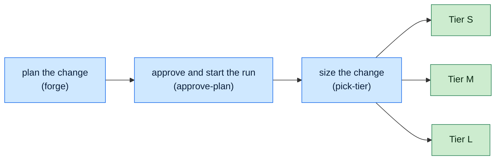
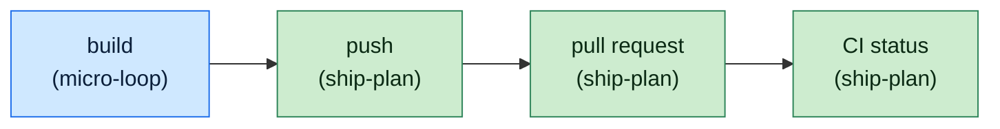
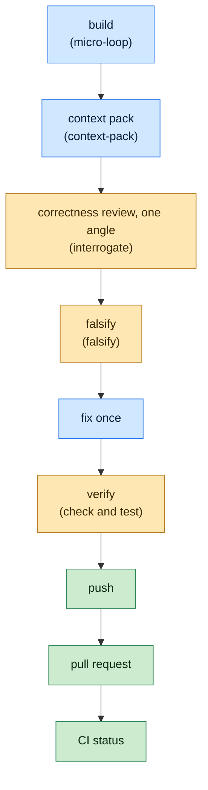
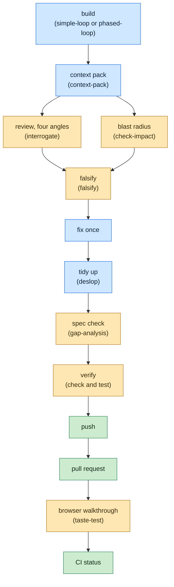

# Skills

Agent skills for a tiered, unattended coding workflow: plan a change with the
agent, approve it, and let the run build, review, verify and ship it to a pull
request.

## Install

```sh
npx skills add richardochristjia/skills -g --list      # see the skills, install nothing
npx skills add richardochristjia/skills -g -s '*' -y   # install every skill globally
npx skills update -g                                   # pull the latest later
```

## How a change flows

1. **forge** plans the change with you and presents a short plan.
2. **approve-plan** turns the approved plan into a spec and a task list, and starts the run.
3. **ship-plan** runs the pipeline unattended, on a branch, and ends with a pull request link.

The plan and fix steps run on Opus. Every other step runs on Sonnet. A run
writes a checkpoint after every step, so an interrupted run resumes instead of
starting over. Nothing beside the harness you are already in is needed: no
terminal multiplexer, no separate session.

## Tiers

**pick-tier** sizes the change as S, M or L, and the tier decides which steps run:

| Tier | Steps |
|---|---|
| S | build, push, pull request, CI status |
| M | build, context pack, one correctness review, falsify, fix once, verify, push, pull request, CI status |
| L | the M steps with a four-angle review, impact check, tidy-up and spec check, plus a browser walkthrough after the pull request |

### Overview



### Tier S



### Tier M



### Tier L



## Skills

```
forge/           plans a change with you before any code is written
approve-plan/    writes the spec and task list, then starts the run
ship-plan/       the pipeline: build to pull request, unattended
pick-tier/       decides the depth of a run from the change's size and risk
micro-loop/      task loop for tier S and M work
simple-loop/     task loop for everyday tier L work
phased-loop/     task loop for phased, risky or large work
context-pack/    one digest of the change, so reviewers don't re-read the repo
interrogate/     four-angle review (or one angle for small changes)
check-impact/    finds what a change could break outside the diff
falsify/         argues against review findings before they are fixed
deslop/          removes AI-generated slop from a branch's code
gap-analysis/    checks an implementation against its acceptance criteria
taste-test/      tries the build like a user, against a committed fixture
diagnose-bug/    finds and proves the cause of a bug, then hands over a fix plan
unslop/          cuts AI tells from writing
wait-what/       restates the last message in plain language
```
